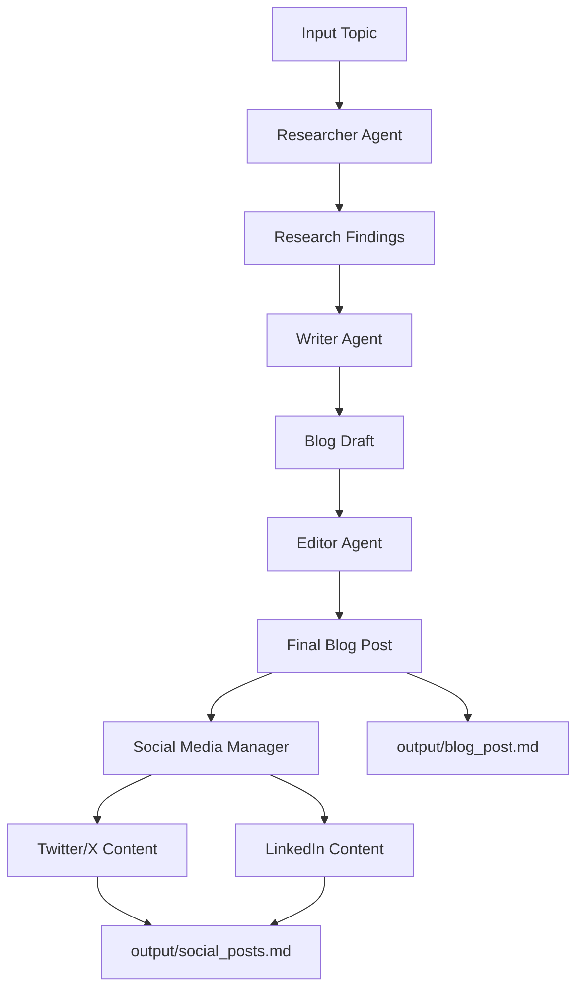

# Wryter — AI-Powered Blog Writing Crew

An AI-powered content creation workflow built with **Python, CrewAI, and Google Gemini**. Wryter uses a team of specialized AI agents to research a topic, write a blog post, edit the draft, and repurpose the final article into engaging social media content for Twitter/X and LinkedIn.

Instead of relying on a single AI prompt to handle the entire content creation process, Wryter separates the work into specialized roles. Each agent contributes to a sequential workflow, making the process more structured, easier to maintain, and extensible.

## Table of Contents

- [Overview](#overview)
- [Features](#features)
- [How It Works](#how-it-works)
- [The AI Agents](#the-ai-agents)
- [Project Structure](#project-structure)
- [Implementation Details](#implementation-details)
- [Technologies Used](#technologies-used)
- [Getting Started](#getting-started)
- [Configuration](#configuration)
- [Running the Project](#running-the-project)
- [Generated Outputs](#generated-outputs)
- [Customizing the Crew](#customizing-the-crew)
- [Security Best Practices](#security-best-practices)
- [Learning Outcomes](#learning-outcomes)
- [Future Improvements](#future-improvements)
- [Author](#author)

## Overview

Wryter demonstrates how multiple AI agents can collaborate to complete a real-world content creation workflow.

Given a topic, the crew carries out four main stages:

1. **Research:** Gather relevant information about the topic.
2. **Writing:** Transform the research into a structured blog post.
3. **Editing:** Review and refine the draft for clarity, readability, and quality.
4. **Social media content creation:** Repurpose the final blog post into platform-appropriate content for Twitter/X and LinkedIn.

The project also explores how agent configurations influence the output. By modifying an agent's role, goal, and backstory, you can change its responsibilities, writing style, and approach to a task.

## Features

- **Multi-agent collaboration:** Specialized agents work together instead of relying on a single general-purpose agent.
- **Sequential task execution:** Each stage builds on the output of the preceding stage.
- **Configurable agents:** Agent roles, goals, and backstories are maintained in YAML files.
- **Reusable task definitions:** Task instructions are separated from Python orchestration logic.
- **AI-powered writing:** Generate blog posts from a specified topic using a configured language model.
- **Content editing:** Improve a draft before saving the final article.
- **Social media repurposing:** Generate shorter, platform-specific content for Twitter/X and LinkedIn.
- **Markdown output:** Save generated content as Markdown files for easy editing, version control, and publishing.
- **Environment-based configuration:** Keep API credentials outside the source code.
- **Extensible architecture:** Add new agents, tasks, and tools as the workflow grows.

## How It Works

Wryter follows a sequential, multi-agent workflow managed by CrewAI.



### Workflow explanation

**1. Topic input**

The workflow receives a topic through the project's configured inputs. A `{topic}` placeholder in task or agent configuration allows the actual subject to be supplied at runtime.

**2. Research**

The Researcher gathers relevant information and produces research findings that the Writer can use as source material.

**3. Writing**

The Writer uses the research findings to create a structured article. This separates information gathering from the task of turning information into readable content.

**4. Editing**

The Editor reviews the draft and improves its clarity, organization, readability, and overall quality. The final article is written to `output/blog_post.md`.

**5. Social media repurposing**

The Social Media Manager takes the completed blog post and transforms it into shorter content tailored to Twitter/X and LinkedIn. The generated content is saved to `output/social_posts.md`.

The workflow is designed so that the social content is based on the completed article rather than being generated independently from the original topic.

## The AI Agents

Each agent has a specific responsibility within the crew.

| Agent | Responsibility | Expected contribution |
|---|---|---|
| Researcher | Investigates the topic and gathers relevant information. | Research findings for the Writer |
| Writer | Converts the research into a coherent blog article. | Initial blog draft |
| Editor | Reviews and improves the draft. | Polished final blog post |
| Social Media Manager | Repurposes the final article for social platforms. | Twitter/X and LinkedIn content |

### Understanding agent configuration

Agent definitions are stored in `src/blog_writing_crew/config/agents.yaml`.

Each agent configuration uses three important fields:

- **Role:** Defines the agent's job or professional identity.
- **Goal:** Describes the outcome the agent is expected to achieve.
- **Backstory:** Provides context about the agent's background and expertise to guide its approach and communication style.

For example, a Researcher may be configured as a topic research analyst whose goal is to gather useful, relevant information. A Social Media Manager can be given a more casual or conversational backstory to influence the tone of its social media output.

These fields guide the model; they do not guarantee that every output will be accurate or follow the instructions perfectly.

## Project Structure

The main CrewAI project lives inside the `blog_writing_crew/` directory.

```text
blog_writing_crew/
├── .gitignore
├── AGENTS.md
├── CLAUDE.md
├── CURSOR.md
├── GEMINI.md
├── README.md
├── knowledge/
│   └── user_preference.txt
├── output/
│   ├── blog_post.md
│   ├── blog_post1.md
│   └── social_posts.md
├── pyproject.toml
├── uv.lock
└── src/
    └── blog_writing_crew/
        ├── __init__.py
        ├── main.py
        ├── crew.py
        ├── config/
        │   ├── agents.yaml
        │   └── tasks.yaml
        └── tools/
            ├── __init__.py
            └── custom_tool.py
```

### Root configuration files

#### `pyproject.toml`

Defines the Python project metadata, dependencies, and development configuration. It is used by the package and environment management workflow to install the libraries required by the project.

#### `uv.lock`

Records resolved dependency versions to help maintain a reproducible Python environment across installations.

#### `.gitignore`

Specifies files and directories Git should ignore, such as virtual environments, temporary files, and sensitive environment configuration.

#### `AGENTS.md`, `CLAUDE.md`, `CURSOR.md`, and `GEMINI.md`

These files provide project-specific guidance for AI coding assistants and development tools. They can document coding conventions, project context, and instructions for making changes. They are not the files that execute the CrewAI workflow.

### Knowledge directory

#### `knowledge/user_preference.txt`

Stores user preference information that may inform content generation when it is referenced by the project's configuration or implementation. Its presence alone does not automatically mean every agent reads it; that depends on how the crew is configured.

### Source code

#### `src/blog_writing_crew/__init__.py`

Marks the package directory and may expose package-level metadata or imports.

#### `src/blog_writing_crew/main.py`

Provides the project's main entry point. In a typical CrewAI scaffold, this module prepares the runtime inputs and invokes the crew. It is also a natural place to configure the topic to process and handle execution errors.

#### `src/blog_writing_crew/crew.py`

Contains the central crew orchestration logic. This is where agents and tasks are connected and the workflow is assembled.

The implementation uses CrewAI's crew-building pattern, including decorators such as `@CrewBase`, `@agent`, `@task`, `@crew`, and the `@CrewBase` configuration mechanism where applicable. The agent and task methods load their definitions from the YAML configuration files.

The crew uses `Process.sequential` to execute tasks in order. This allows later tasks to use results produced by earlier tasks.

#### `src/blog_writing_crew/config/agents.yaml`

Defines each agent's role, goal, and backstory. This keeps the agents' responsibilities separate from the Python orchestration code.

The Social Media Manager is added here alongside the original Researcher, Writer, and Editor agents.

#### `src/blog_writing_crew/config/tasks.yaml`

Defines the work that the agents perform. Task configurations generally specify a description, expected output, and the agent responsible for completing the task.

The workflow contains tasks for research, writing, editing, and social media content creation. The Social Media Manager's task instructs it to repurpose the completed blog post for Twitter/X and LinkedIn.

#### `src/blog_writing_crew/tools/__init__.py`

Initializes the tools package so its modules can be imported as part of the project.

#### `src/blog_writing_crew/tools/custom_tool.py`

Provides a location for custom tool implementations. Custom tools can extend the agents' capabilities beyond text generation by allowing them to perform specific operations. The precise behavior depends on the implementation defined in this file.

### Generated output files

#### `output/blog_post.md`

Contains a generated blog article. The editing task is configured to save the polished result here.

#### `output/blog_post1.md`

Contains an additional generated blog-post artifact from the project. It is kept separately from `blog_post.md` rather than being treated as the primary output path.

#### `output/social_posts.md`

Contains social media content generated from the completed blog post, including content intended for Twitter/X and LinkedIn.

The output directory makes it easy to inspect the results without having to read the entire execution log.

## Implementation Details

### 1. Separating configuration from orchestration

One of the main architectural decisions is to store agent and task definitions in YAML instead of hardcoding all instructions in Python.

This separation provides several advantages:

- Agent instructions can be updated without rewriting the orchestration logic.
- Task descriptions are easier to read and maintain.
- New agents and tasks can be added in a consistent format.
- The Python code focuses on connecting components and executing the workflow.

The method names in `crew.py` must match the corresponding configuration keys in the YAML files. CrewAI uses these mappings to associate the correct settings with each agent and task.

### 2. Defining the tasks

Each task describes a specific stage of content production.

The research task gathers information, the writing task transforms that information into an article, and the editing task refines the draft. The social media task then repurposes the completed article.

The `output_file` field specifies where a task's output should be saved. In this implementation, the editing task writes the final article to `output/blog_post.md`, while the social media task writes the platform content to `output/social_posts.md`.

Intermediate tasks can pass their results through the CrewAI workflow without every task needing to save a separate file.

### 3. Connecting the agents and tasks

The crew orchestration layer connects the YAML definitions to Python objects.

Conceptually, the implementation follows this pattern:

```python
@agent
def researcher(self) -> Agent:
    return Agent(
        config=self.agents_config["researcher"],
        verbose=True,
    )

@task
def research_task(self) -> Task:
    return Task(
        config=self.tasks_config["research_task"],
    )

@crew
def crew(self) -> Crew:
    return Crew(
        agents=self.agents,
        tasks=self.tasks,
        process=Process.sequential,
        verbose=True,
    )
```

This snippet illustrates the CrewAI configuration pattern; it is not intended to replace the complete implementations in `crew.py`. The actual method names and configuration keys must match the files in the project.

The sequential process establishes the execution order, while task outputs provide context for downstream work.

### 4. Using a topic variable

The `{topic}` placeholder allows the project to work with different subjects without rewriting the agent and task instructions each time.

For example, a task description might refer to `{topic}` when asking the Researcher to investigate a subject. The runtime input supplies the actual value.

This makes the workflow reusable for different blog topics.

### 5. Adding the Social Media Manager

The Social Media Manager extends the original blog-writing crew rather than replacing it.

Its implementation requires three coordinated changes:

1. Add the agent definition to `agents.yaml`.
2. Add the social media task definition to `tasks.yaml`.
3. Add the corresponding agent and task methods to `crew.py` and include them in the crew's execution sequence.

The social media task uses the completed blog post as its source material. This makes the resulting posts derivatives of the main article, while allowing the tone, length, and presentation to vary by platform.

### 6. Experimenting with agent backstories

The project also demonstrates how agent configuration can affect generated content.

Changing the Social Media Manager's backstory to describe a more casual, Gen Z-oriented personality can encourage a more conversational and expressive writing style.

This illustrates an important prompt-engineering principle: the role, goal, and contextual instructions supplied to an agent influence its behavior and output.

## Technologies Used

| Technology | Purpose |
|---|---|
| Python | Implements the project and orchestrates the workflow. |
| CrewAI | Defines agents, tasks, crews, and sequential execution. |
| Google Gemini | Provides the configured language model for content generation. |
| YAML | Stores agent definitions and task instructions. |
| uv | Manages Python dependencies and the project environment. |
| Markdown | Stores generated blog posts and social media content. |
| Git and GitHub | Track source changes and host the project repository. |
| VS Code | Development environment used to work on the project. |

## Getting Started

### Prerequisites

Before running the project, ensure you have:

- Python compatible with the project's `pyproject.toml` requirements.
- [uv](https://docs.astral.sh/uv/) installed.
- A Google Gemini API key for the configured language model.
- Any additional API keys required by the tools enabled in the project.
- Git, if you intend to clone the repository.

### 1. Clone the repository

```bash
git clone https://github.com/chiscookeke11/wryter.git
cd wryter/blog_writing_crew
```

If you have already cloned the repository, navigate directly to its `blog_writing_crew` directory.

### 2. Install dependencies

Use uv to install the project and its dependencies:

```bash
uv sync
```

This uses the dependency declarations and lock file to set up the environment.

### 3. Configure environment variables

Create a `.env` file in the location expected by the project configuration and provide your API credentials.

For example, the configuration may include:

```env
MODEL=gemini/gemini-2.0-flash-thinking-exp-01-21
GEMINI_API_KEY=your_gemini_api_key
SERPER_API_KEY=your_serper_api_key
```

Replace the example values with your actual configuration. The precise model name and environment-variable names must match the LLM and tool integrations configured in your project.

The Serper API key is relevant if the configured research tools use Serper. Only configure the additional keys required by the tools and integrations you actually use.

**Never commit your real `.env` file or API keys to GitHub.** Use `.env.example` to document the required variable names with placeholder values.

### 4. Run the crew

From the project directory, run:

```bash
crewai run
```

This invokes the CrewAI project through its configured entry point. Follow any errors or prompts in the terminal, and confirm that the expected files are generated or updated in the `output/` directory.

If the command is unavailable in your shell, check that the project dependencies were installed correctly and that you are using the project's environment.

## Configuration

### Changing the topic

Update the runtime input for the topic in the configured entry point or provide it through the mechanism already implemented by the project.

For example, a topic could be:

```python
inputs = {
    "topic": "How AI Agents Are Changing Software Development"
}
```

This is an example of the input structure commonly used by CrewAI; adapt it to the actual input handling in `main.py`.

### Changing an agent's behavior

Edit the relevant entry in `src/blog_writing_crew/config/agents.yaml`.

You can adjust:

- The agent's role.
- The result it should aim to achieve.
- Its background and communication style.

### Changing a task's instructions

Edit `src/blog_writing_crew/config/tasks.yaml` to change what an agent should produce, how it should approach the work, or where its output should be saved.

When changing configuration keys, update the corresponding method names or references in `crew.py` as necessary.

## Running the Project

A typical execution follows this sequence:

1. The application loads the runtime input and configuration.
2. CrewAI initializes the configured agents.
3. The research task runs.
4. The writing task uses the research output.
5. The editing task produces the final blog post.
6. The Social Media Manager creates platform-specific content.
7. The configured output files are written to disk.

Check the terminal output for execution errors and inspect the Markdown files to evaluate the generated content.

AI-generated content should be reviewed before publication, especially when it includes factual claims, statistics, references, or advice.

## Generated Outputs

After a successful run, the main artifacts to inspect are:

| File | Purpose |
|---|---|
| `output/blog_post.md` | Final blog post produced by the editing stage. |
| `output/blog_post1.md` | Additional blog-post artifact retained in the output directory. |
| `output/social_posts.md` | Social media content based on the completed blog post. |

The exact contents may change between runs depending on the topic, model behavior, agent instructions, and available tools.

## Customizing the Crew

Wryter is designed to be extended.

Potential improvements include:

- **Add a fact-checking agent:** Review claims and verify references before publication.
- **Add a content strategist:** Define the audience, search intent, and content outline before writing begins.
- **Add a platform-specific workflow:** Create separate tasks for LinkedIn posts, Twitter/X threads, newsletters, and other channels.
- **Add automated quality checks:** Validate article structure, formatting, length, and required sections.
- **Add publishing integrations:** Send approved content to a content management system or publishing platform.
- **Improve source traceability:** Preserve research links and references so readers can verify important claims.
- **Add tests:** Test configuration loading, workflow setup, input handling, and output-file generation.

These are possible extensions rather than claims about functionality already implemented in the current version.

## Security Best Practices

- Keep API keys in environment variables or an appropriate secrets manager.
- Ensure `.env` is excluded from version control.
- Commit `.env.example` with placeholder values only.
- Avoid placing private credentials or sensitive information in agent configuration files.
- Review generated content before publishing it externally.
- Treat web-retrieved material as untrusted input and verify important claims.

## Learning Outcomes

Building this project provided practical experience with:

- Designing a multi-agent AI workflow.
- Defining agent roles, goals, and backstories.
- Creating reusable tasks using YAML configuration.
- Connecting agents and tasks through CrewAI decorators.
- Managing sequential task execution and passing outputs between agents.
- Integrating a language model into a Python application.
- Generating and saving structured Markdown content.
- Extending an existing workflow with a Social Media Manager.
- Experimenting with prompt instructions to influence writing style.
- Managing Python dependencies and environment variables.

## Author

**Chinedu Okeke Emmanuel**

Software Engineer | AI/ML Engineer | Open Source Contributor

- GitHub: [@chiscookeke11](https://github.com/chiscookeke11)
- Project repository: [chiscookeke11/wryter](https://github.com/chiscookeke11/wryter)

---

*Wryter is a learning project exploring multi-agent orchestration and AI-assisted content creation with CrewAI and Google Gemini.*
